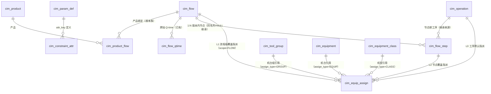

# 我们的完整设计：ICM 继承式约束模型（定稿）

> 前置阅读：[00-overview.md](00-overview.md)（架构选型）、[10-ref-analysis.md](10-ref-analysis.md)（参考项目基线）、[60-industry-patterns.md](60-industry-patterns.md)（行业模式调研）。
> **本方案不使用 FSD/FOD 体系**（用户拍板）。行业对标结论：Camstar/SiView 走「规格引用复用」、myCIM 走「节点强类型参数 + 多层级 Context」、Applied 走「运行时校验」——三者收敛的共同点是**「工序级复用 + 节点级覆盖」**。我们的自有方案将其提炼为一等公民：**ICM（Inherited Constraint Model，继承式约束模型）**。
> 命名沿用 MDS 现状：`cim_` 前缀、审计六件套、编辑锁三列。

## 0. ICM 三原则（自有方案的灵魂）

1. **值继承（ContextChain）**：节点参数沿**上下文链**逐层继承，取最特异层：

   ```
   ContextChain（MDS 主数据范围）：
   L0 OPERATION 工序模板默认 ─→ L1 FLOW 流程级覆盖 ─→ L2 STEP 节点覆盖 ─→ (P3: L3 PRODUCT 产品级) ─→ LOT 批次=MES 运行态，MDS 不建模
   解析顺序（特异→一般）：STEP > FLOW > OPERATION（P3 加入后 PRODUCT > STEP > FLOW > OPERATION）
   ```

   **新建流程拖入工序列节点即带全套默认值**——零覆盖即可通过校验，这是与所有对标产品拉开差距的动线；流程级一行覆盖可整条流程统一策略（如 ENG 流程全流程限定工程机台组），对标 myCIM 多层级 Context（工步/工序/流程/产品/批次）的主数据可达子集。
2. **一处配置全厂受益（精确语义）**：工序页是配置中心（L0），画布只做差异覆盖（L2）。**注意**：`cim_flow_step.operation_code` 指向的是**具体工序版本行**（cim_operation 同族唯一 ACTIVE、每版本独立 op_code）——工序升版产生新 op_code，旧流程节点**不会**自动漂移到新版（这是 WIP 稳定性所必须的：已生效流程的行为不允许随模板升级而变）。「受益」的落地方式：UNFROZEN 流程提供**「刷新工序引用」批量动作**（按 op_family_code 将节点指到族内最新 ACTIVE 版本，逐节点 diff 预览后确认），校验规则 `OP_REF_STALE`（WARN）提示可刷新的节点。继承链的「自动跟随」仅指**同一工序版本行内的默认值修订**（UNFROZEN 的工序改默认值，未覆盖节点即时跟随）。
3. **覆盖透明（来源标注）**：所有展示点（画布徽标/参数面板/批量维护表/对比/校验报告）标注每个值的**来源层级**：`节点覆盖（蓝）/ 流程覆盖（青）/ 工序默认（灰）/ 缺失（红）`；「一键还原」=清除本层覆盖、回落上一层。

## 1. ER 总览（P1 范围）



关键点：
- **节点覆盖列与工序默认列逐一同名**（recipe_ref/qtime/rework_limit/batch/hold/inspect/sampling/reticle/chamber…V12-V20 已天然对齐），继承模型几乎零迁移成本；
- **指派（equip_assign）与 KV（attr）两张表天然按 scope 承载全 ContextChain**——同一张表、同一套服务/组件/Excel 模板覆盖 工序/流程/节点 三个上下文，加 PRODUCT 只是扩枚举；
- 列型约束**只在 OPERATION/STEP 两级**（保持零迁移红利；FLOW 级只开放指派与 KV——整条流程统一机台池/策略型参数，不给 cim_flow 塞语义不清的列）。

## 2. DDL（h2 + mysql 双方言，V22 起）

### 2.1 cim_flow 增强（生效闸 + 返工标注 + 工序刷新基线）

```sql
ALTER TABLE cim_flow ADD COLUMN validate_state  VARCHAR(16) NOT NULL DEFAULT 'NOT_VALID';  -- NOT_VALID/VALID/INVALID
ALTER TABLE cim_flow ADD COLUMN validate_time   TIMESTAMP;
ALTER TABLE cim_flow ADD COLUMN validate_user   VARCHAR(64);
ALTER TABLE cim_flow ADD COLUMN validate_msg    VARCHAR(1024);   -- 失败摘要（明细在 validate_result）
ALTER TABLE cim_flow ADD COLUMN stage_code      VARCHAR(64);     -- 站点分组轴（P2 填数据）
ALTER TABLE cim_flow ADD COLUMN rework_of_family VARCHAR(64);    -- 空=正常流程；非空=「XX 族流程的返工流程」标注列（跳转时机归 MES，MDS 只管定义与筛选）
-- 编辑锁三列（评审轮3补充）：cim_flow 现无锁（V12-V21 均未建，Flow 域服务也无 EditLock 判定），
-- 而画布保存是「XML 整份回传覆盖」——两人同时编辑后保存者互相静默覆盖，是全系统并发风险最高点。
--   ALTER TABLE cim_flow ADD COLUMN is_occupied  BOOLEAN NOT NULL DEFAULT FALSE;
--   ALTER TABLE cim_flow ADD COLUMN occupied_by  VARCHAR(64);
--   ALTER TABLE cim_flow ADD COLUMN occupied_at  TIMESTAMP;
--   口径：锁管「人 vs 人」（saveCanvas/覆盖数据编辑/refresh-operations 前判锁，同 EditLockSupport 模式），
--   四态管「版本生命周期」（非 UNFROZEN 禁改）——两层独立叠加，不互替。

CREATE TABLE cim_flow_validate_result (
    id           VARCHAR(64)  NOT NULL,
    flow_id      VARCHAR(64)  NOT NULL,
    step_id      VARCHAR(64),              -- 空=流程级错误
    rule_code    VARCHAR(64)  NOT NULL,    -- 见 §5
    severity     VARCHAR(16)  NOT NULL,    -- ERROR / WARN
    message      VARCHAR(512) NOT NULL,
    CONSTRAINT pk_cim_flow_validate_result PRIMARY KEY (id)
);
CREATE INDEX idx_fvr_flow ON cim_flow_validate_result (flow_id);
```

> **多方案/多场景不加列**：同产品多工艺方案（量产/工程/N+1）= 多个 flow family（命名约定 `ENG-*`/`HVM-*`，产品绑定表可绑到任意族）；需要方案横评时走流程对比的跨族模式。不引入 scenario_code 冗余轴。

### 2.2 统一指派表 cim_equip_assign（ICM 核心，ContextChain 三 scope 复用）

> 替代上一版 step_machine/step_reticle 两张表。**工序默认 / 流程级覆盖 / 节点覆盖指派共用一张表**——同一个 Service/Controller/前端编辑组件/Excel 模板全复用，这是「便于配置」的落地，也是 myCIM 多层级 Context 的显式化实现。

```sql
CREATE TABLE cim_equip_assign (
    id              VARCHAR(64)  NOT NULL,
    -- 审计列略（同全家桶）
    scope_type      VARCHAR(16)  NOT NULL,   -- OPERATION / FLOW / STEP（P3 加 PRODUCT）
    operation_code  VARCHAR(64)  NOT NULL DEFAULT '',   -- scope=OPERATION 时填；其余空串占位
    flow_id         VARCHAR(64)  NOT NULL DEFAULT '',   -- scope=FLOW/STEP 时填；其余空串占位
    step_id         VARCHAR(64)  NOT NULL DEFAULT '',   -- 仅 scope=STEP 填；其余空串占位
    assign_type     VARCHAR(16)  NOT NULL,   -- GROUP / EQUIP / CLASS
    assign_ref      VARCHAR(64)  NOT NULL,   -- 组=toolGroup.group_code / 机=equipment_code / 型=equipmentClass.class_code
    chamber_rule    VARCHAR(512),            -- JSON 槽位→腔位规则，如 {"1":["CH-A","CH-B"]}；空=任意腔
    recipe_ref      VARCHAR(64),             -- FIXED PPID（recipe_rule=FIXED 时必填）
    recipe_rule     VARCHAR(16)  NOT NULL DEFAULT 'FIXED',  -- FIXED / GENERATE / EXACT_MATCH
    recipe_match    VARCHAR(512),            -- EXACT_MATCH JSON（键值匹配前次量测等）
    priority        INT NOT NULL DEFAULT 100,-- 候选池顺序
    enabled         BOOLEAN NOT NULL DEFAULT TRUE,
    remark          VARCHAR(512),
    CONSTRAINT pk_cim_equip_assign PRIMARY KEY (id),
    CONSTRAINT uk_ea UNIQUE (scope_type, operation_code, flow_id, step_id, assign_type, assign_ref, priority, deleted)
);
-- ⚠️ 唯一键 NULL 陷阱：MySQL/H2 唯一索引不约束含 NULL 的行（多行 NULL 视为互异），
--    上下文三列必须 NOT NULL DEFAULT '' 空串占位，唯一键才真实生效（cim_tool_group_member 同款经验）。
-- 守门：
--  scope=OPERATION → operation_code 非空串且存在；scope=FLOW → flow_id 非空串且存在、step_id=''；
--  scope=STEP → flow_id+step_id 非空串且存在；
--  assign_type=GROUP → assign_ref ∈ cim_tool_group（enabled）；EQUIP → ∈ cim_equipment；CLASS → ∈ cim_equipment_class；
--  assign_type=CLASS/EQUIP 行的机型须与节点资格一致（见 ASSIGN_MATCHES_EQUIP_TYPE，§5）；
--  recipe_rule=FIXED → recipe_ref 必填；EXACT_MATCH → recipe_match 合法 JSON；
--  多层并存时按 ContextChain 取最特异层（STEP > FLOW > OPERATION）。
--  **四态只读**：所属流程 status≠UNFROZEN 时，scope=FLOW/STEP 行禁改禁删（2004）；要改 = copy 新版本。
-- 典型用法：scope=FLOW 一行 GROUP 指派 → 整条流程（如 ENG 流程限定工程机组）无需逐节点配。
```

> **资格门 vs 候选池（与现有 equip_type 列的分工）**：`cim_flow_step.equip_type`（ET-*，V12 已有）= **资格门**——该节点「能由哪类设备做」的硬约束；`cim_equip_assign` = **候选池**——派工用具体组/机/型清单。解析时取 `候选池 ∩ 资格门`；两者语义不同、都保留，靠校验规则约束一致性。
```

### 2.3 节点覆盖列（语义改造 + 补列）

cim_flow_step 现有列（recipe_ref/equip_type/qtime_min/max/rework_limit/batch_mode/batch_size/hold_point/hold_reason/inspect_plan/sampling_rate）**语义改为覆盖层：NULL=继承工序默认**。补三列：

```sql
ALTER TABLE cim_flow_step ADD COLUMN reticle_ref      VARCHAR(256);  -- 覆盖光罩引用（CSV，空=继承 operation.reticle_ref）
ALTER TABLE cim_flow_step ADD COLUMN contam_level     VARCHAR(16);   -- 覆盖进站污染级（空=继承；对标 myCIM 污染等级控制）
ALTER TABLE cim_flow_step ADD COLUMN contam_forbidden VARCHAR(128);  -- CSV 禁止进入的污染级（空=继承）
```

> 上版 step_contamination 多行表砍掉：6 寸厂污染控制是单值+禁止清单语义（myCIM 同），列承载足够；将来 12 寸需要多套污染策略时再显式建表（渐进显式化原则不变）。

### 2.4 KV 长尾参数 + 参数定义（ContextChain 泛化）

```sql
CREATE TABLE cim_param_def (           -- 参数定义字典（对标 FodModeler 的显式化替代）
    id              VARCHAR(64)  NOT NULL,
    attr_key        VARCHAR(64)  NOT NULL,   -- 建后不可改（同 product_code 口径）
    attr_name       VARCHAR(128) NOT NULL,
    group_code      VARCHAR(64)  NOT NULL,   -- 展示分组：DC / PILOT / SEASON / SPC…
    value_type      VARCHAR(16)  NOT NULL,   -- STRING / INT / DECIMAL / BOOLEAN / ENUM / JSON
    enum_dict       VARCHAR(64),             -- value_type=ENUM 时引平台字典
    required        BOOLEAN NOT NULL DEFAULT FALSE,
    scopes          VARCHAR(64)  NOT NULL DEFAULT 'STEP',  -- 可配置上下文 CSV：OPERATION/FLOW/STEP（P3 加 PRODUCT）
    sort_no         INT NOT NULL DEFAULT 100,
    enabled         BOOLEAN NOT NULL DEFAULT TRUE,
    CONSTRAINT pk_cim_param_def PRIMARY KEY (id),
    CONSTRAINT uk_param_def UNIQUE (attr_key, deleted)
);

-- KV 值表按 ContextChain 泛化（替代上版 cim_flow_step_attr 单层表）：
-- 一张表承载 工序默认 attr / 流程级 attr / 节点覆盖 attr，继承规则与列型约束一致。
CREATE TABLE cim_constraint_attr (
    id            VARCHAR(64)  NOT NULL,
    context_type  VARCHAR(16)  NOT NULL,   -- OPERATION / FLOW / STEP（P3 加 PRODUCT）
    operation_code VARCHAR(64) NOT NULL DEFAULT '',   -- context=OPERATION 时填；空串占位（同 uk_ea NULL 陷阱规避）
    flow_id       VARCHAR(64)  NOT NULL DEFAULT '',
    step_id       VARCHAR(64)  NOT NULL DEFAULT '',
    attr_key      VARCHAR(64)  NOT NULL,
    attr_value    VARCHAR(1024),
    CONSTRAINT pk_cim_constraint_attr PRIMARY KEY (id),
    CONSTRAINT uk_cattr UNIQUE (context_type, operation_code, flow_id, step_id, attr_key, deleted)
);
-- 解析：param_def.scopes 决定 attr_key 可出现在哪些层（守门）；取值沿链取最特异层。
-- 四态只读：所属流程 status≠UNFROZEN 时 context=FLOW/STEP 行禁改禁删。
```

### 2.5 产品↔流程绑定（保留上版设计）

```sql
CREATE TABLE cim_product_flow (
    id              VARCHAR(64)  NOT NULL,
    -- 审计列略
    product_code        VARCHAR(64) NOT NULL,
    flow_family_code    VARCHAR(64) NOT NULL,
    flow_version_no     INT         NOT NULL,
    bind_state          VARCHAR(16) NOT NULL DEFAULT 'ACTIVE',   -- ACTIVE / HISTORY
    active_time         TIMESTAMP,
    active_user         VARCHAR(64),
    -- 编辑锁三列
    is_occupied     BOOLEAN NOT NULL DEFAULT FALSE,
    occupied_by     VARCHAR(64),
    occupied_at     TIMESTAMP,
    CONSTRAINT pk_cim_product_flow PRIMARY KEY (id),
    CONSTRAINT uk_cim_product_flow UNIQUE (product_code, flow_family_code, flow_version_no, deleted)
);
```

守门：同 (product_code, flow_family_code) 最多一条 ACTIVE；绑定版本须 ACTIVE（或 FROZEN+VALID 允许预绑定，投批解析到 ACTIVE）；**流程 disable 时若有 ACTIVE 绑定则 2004 拒绝**（先解绑再淘汰，防悬挂绑定——评审轮3补充）。

> **ContextChain 预留（P3）**：产品级上下文 = `cim_equip_assign/cim_constraint_attr` 扩 `scope_type=PRODUCT`（product_code+flow_family_code 定位，对「该产品走这条流程的所有节点」生效）+ 列型约束在 cim_product_flow 加同名列。P1 只建绑定关系，不建覆盖——先用「绑不同流程版本」表达产品差异。

## 3. 继承解析规则（ICM 运行时语义，开发对照表）

> 解析顺序：**STEP > FLOW > OPERATION**（P3 加入后 PRODUCT > STEP > FLOW > OPERATION）。取值方向：从最特异层向下找第一个非空值；全链为空按「空+空时」列处置。

| 字段 | L0 工序默认 | L1 流程级覆盖 | L2 节点覆盖 | 空+空时 |
| --- | --- | --- | --- | --- |
| 机台指派 | cim_equip_assign(scope=OPERATION) 多行 | cim_equip_assign(scope=FLOW) 多行 | cim_equip_assign(scope=STEP) 多行 | 校验 ERROR（MAIN 节点） |
| 机台资格门 | op.equip_type（ET-*） | — | step.equip_type（ET-*） | 放行；与候选池交集判一致性（§5 规则） |
| recipe_ref / recipe_rule | op.recipe_ref | —（FLOW 级不开放列型） | step.recipe_ref（assign 内 recipe 优先） | 校验 ERROR |
| reticle_ref | op.reticle_ref（单值） | — | step.reticle_ref（CSV） | 仅 LITHO 类节点报 ERROR，其余放行 |
| contam_level / forbidden | —（工序通常不定） | — | step.contam_* | 放行（WARN 提示） |
| qtime_min/max | op.qtime_min/max（单站语义） | — | step 同名 | 放行 |
| rework_limit / batch_* / hold_* / inspect_plan / sampling_rate | op 同名列 | — | step 同名列 | 放行 |
| capability / edc_plan | op.capability_code / edc_plan_code | — | step 同名（实体已有列） | 放行 |
| KV（cim_constraint_attr） | context=OPERATION | context=FLOW | context=STEP | required=true 报 ERROR |

解析实现：`ContextResolver`（纯函数，入 `ResolveCtx{product?, flow, step, operation, assign 行集, attr 行集}` → 出 `EffectiveValue{value, source: STEP_OVERRIDE / FLOW_OVERRIDE / OPERATION_DEFAULT / MISSING}`）。**校验、对比、Excel 导出、画布面板四条链路都消费同一解析器**——单一事实源，不允许各处各算。`source` 即 UI 的来源标注（三态可视化升级为来源层级标注）。解析语义三个要点：① `operation` 按 `step.operation_code` **钉死版本行**解析（已生效流程不受工序升版影响，见 §0 原则 2）；② 机台候选池 = `assign 候选 ∩ equip_type 资格门`，交集为空报 ERROR；③ 全部取值为纯函数、无 IO，画布可安全逐节点/批量调用。

## 4. API 契约（P1，统一 `Result<T>` + `/api/v1/mds` 前缀 + 权限码三处同步）

> **权限码风格注（评审轮1核实）**：MdsPermissions 现网风格是 `mds:<资源>:view|create|update|delete` 四动作（资源名驼峰，如 `mds:toolGroup:view`），**无 `:read`、无 `:*` 通配权限**。下表 `*` 是表格缩写，落地=四动作四码；`mds:flow:validate` 是四动作之外的特例第五码（理由：质检角色只需「跑校验+看报告」不需改流程，单独授权是常见诉求）。

| 方法 | 端点 | 权限码 | 说明 |
| --- | --- | --- | --- |
| GET | /flows/{id}/steps/{stepId}/effective | mds:flow:view | **ICM 关键端点**：沿 ContextChain 解析生效值 + 每字段来源标注（节点覆盖/流程覆盖/工序默认/缺失）；预留 `?product=` 查询参数（P3 生效） |
| GET | /flows/{id}/effective | mds:flow:view | **批量解析**：一次返回全节点生效值（画布渲染/对比/Excel 用，避免逐节点 N+1） |
| GET | /flows/{id}/step-flags | mds:flow:view | **列表页轻量聚合**（评审轮4补录，P01 原型已引用）：每流程启用节点数/缺指派节点数，避免列表页逐行调 effective |
| POST | /flows/{id}/refresh-operations | mds:flow:update | **工序刷新**（仅 UNFROZEN+未锁）：按 op_family_code 将各节点指到族内最新 ACTIVE 版本；请求体传 stepIds 支持部分刷新；响应带逐节点新旧 op_code diff |
| GET/POST/PUT/DELETE | /operations/{opCode}/assigns[/{id}] | mds:opAssign:* | L0 工序默认指派 |
| GET/POST/PUT/DELETE | /flows/{flowId}/assigns[/{id}] | mds:flowAssign:* | L1 流程级覆盖指派（整流程统一机台池） |
| GET/POST/PUT/DELETE | /flows/{flowId}/steps/{stepId}/assigns[/{id}] | mds:stepAssign:* | L2 节点覆盖指派 |
| POST | /flows/{id}/validate | mds:flow:validate | **增强已有端点**（FlowController 现有 validate 只跑图结构校验、不落库）：扩展为跑 §5 表驱动规则，落 validate_state + validate_result（REQUIRES_NEW） |
| GET | /flows/{id}/validate-result | mds:flow:view | 校验报告 |
| POST | /flows/{id}/copy | mds:flow:create | **增强已有端点**（copy 已存在）：按 §6 搬运规则扩展（搬运 assign/attr；rule 仍不自动复制） |
| GET | /flows/compare?leftFamily&leftVersion&rightFamily&rightVersion | mds:flow:view | 对比（按**解析值** diff，继承/流程级变化也可见；支持跨族=方案横评） |
| GET/PUT | /operations/{opCode}/attrs | mds:opAttr:* | KV 参数 L0（PUT 批量 upsert） |
| GET/PUT | /flows/{flowId}/attrs | mds:flowAttr:* | KV 参数 L1（整流程统一策略型参数） |
| GET/PUT | /flows/{flowId}/steps/{stepId}/attrs | mds:stepAttr:* | KV 参数 L2（三层共用 AttrService） |
| GET/POST/PUT/DELETE | /param-defs[/{id}] | mds:paramDef:* | 参数定义字典（scopes 控可配层级） |
| GET/POST/DELETE | /product-flows[/{id}] | mds:productFlow:* | 产品绑定（POST=绑定/激活） |
| GET | /products/{code}/flows | mds:productFlow:view | 产品绑定历史 |

**状态机补丁**：activate 前置校验 `validate_state=VALID`（2004 拒绝）；freeze 沿用现状「图校验通过才放行」（WARN 不拦截），并在 freeze/activate 时自动跑全量规则刷新 validate_state；**非 UNFROZEN 流程的覆盖数据（assign/attr/覆盖列）一律只读**（守门 2004，改 = copy 新版本）；**flow disable 前查 ACTIVE 产品绑定**——存在则 2004 提示先解绑（评审轮3补充：否则出现「绑定指向 DISABLED 流程」的悬挂绑定）。

## 5. 校验规则清单（表驱动，rule_code 可启停）

| rule_code | 规则 | severity | 对标 |
| --- | --- | --- | --- |
| FLOW_NODE_REQUIRED | 流程至少 1 个 Operation 节点 | ERROR | NODE_POSITION_REQUIRED |
| ASSIGN_REQUIRED | MAIN 节点解析后 ≥1 条启用指派（含继承工序默认） | ERROR | FSD_MACHINE_REQUIRED |
| ASSIGN_REF_VALID | assign_ref 按类型存在于 toolGroup/equipment/class 且 enabled | ERROR | FSD_MACHINE_INVALID |
| ASSIGN_MATCHES_EQUIP_TYPE | 候选池行（CLASS/EQUIP 型）的机型与节点资格门（step/op 的 equip_type）一致 | ERROR | — |
| OP_REF_EXISTS | step.operation_code 存在且为 ACTIVE 版本（沿用现状画布守门口径：只有 ACTIVE 工序可被节点引用；工序被引用即禁删禁禁用，OperationAdminService 已实现 2004 守门） | ERROR | — |
| OP_REF_STALE | 节点引用的工序族存在更新版本（族内有其他 ACTIVE op_code ≠ 当前引用） | WARN（提示可「刷新工序引用」） | — |
| RECIPE_RESOLVED | 解析后 recipe_rule=FIXED→有 ref；EXACT_MATCH→JSON 合法 | ERROR | — |
| RETICLE_RESOLVED | LITHO 节点解析后 reticle_ref 非空且引用存在 | ERROR | — |
| CONTAM_VALID | forbidden 不含自身 contam_level | ERROR | — |
| QTIME_REACHABLE | 每条 qtime 终点节点可达（复用 validateGraph 规则 8） | ERROR | — |
| STRUCTURE_VALID | 既有画布结构校验（主线可达/SPLIT MERGE 度约束/批次模式） | ERROR | — |
| PARAM_KEY_DEFINED | attr_key 在 param_def 注册且 enabled | WARN | — |
| PARAM_REQUIRED_MISSING | required=true 的 key 无值 | WARN | — |
| OVERRIDE_SAME_AS_DEFAULT | 覆盖值与下层默认相同（提示冗余覆盖） | WARN | — |

validate 实现：逐规则跑（规则注册表可启停），ERROR≥1 → INVALID；0 ERROR 有 WARN → VALID；明细落 validate_result，摘要写 flow.validate_msg。**校验一律消费 ContextResolver 的解析值**。

## 6. 版本复制规则（对标 FsdAndFodDuplicator，显式化实现）

copy(newVersion) 时：

1. 复制 cim_flow 行：新 flow_code（命名规则）、family_code 不变、version_no=max+1、status=UNFROZEN、validate_state=NOT_VALID、validate_* 清空、编辑锁清空；
2. 复制 steps/edges/qtime：按 step_code 建映射；**NULL 覆盖列保持 NULL**（继承自动跟随工序默认——ICM 特有优势：工序默认升级后新旧版本未覆盖节点同时受益）；**step.operation_code 原样带过**（钉版本行语义：新版流程仍指同一工序版本，不因复制而漂移到族内最新）；
3. **cim_flow_rule 不自动复制**（V15 已定口径：规则锚定 family_code+version_no、跨版本手选复用，显式维护——评审轮2修正，原稿误写「复制 rule」与 V15 迁移注释矛盾）；rule 内 step_code/node_id 引用由手选复用时的适配动作处理（后续增强，不阻塞 P1）；
4. 搬运 assign/attr 行：scope=FLOW（context=FLOW）与 scope=STEP 的行全量复制（FLOW 级按新 flow_id 重挂；STEP 级按 node_id 搬——copy 时 node_id 原样克隆；实施定稿：step_id 列引用 cim_flow_step.node_id 而非主键 id，因 saveXml 全量重建 step 表后主键会换、node_id 保存后稳定）；scope=OPERATION 行**不搬**（模板共享，改工序默认全体受益）；新出现的 step → 无覆盖指派（沿链继承，链空则校验 ERROR 定位）；被删 step → 行不搬，日志记录；
5. attr 与下层默认同值的行不复制（解析器会沿链回落，减少冗余行）。

同版本编辑删节点：连带删 scope=STEP 的 assign 行 + attr 行（事务内）。

## 7. 与行业三模式的关系（我们站哪）

| 行业模式 | 代表 | 我们吸收 | 我们舍弃 |
| --- | --- | --- | --- |
| A 规格引用复用 | Camstar Workflow→Spec、SiView SM | 工序模板=复用单位；节点引用工序继承默认 | Spec 独立版本化（我们的工序族已有版本） |
| B 节点强类型参数 + Context 层级 | myCIM PRP（返工/Q-time 等支持 工步/工序/流程/产品/批次 多层级 Context） | **ContextChain 作为一等公民**：OPERATION→FLOW→STEP 三级主数据链（P3 加 PRODUCT），指派/KV 按 scope 一张表承载全链，解析取最特异层并标注来源 | 批次级 Context（MES 运行态，MDS 边界外）；五级一次到位（渐进） |
| C 运行时校验 | Applied runtime spec validation、芯享 PPC | 表驱动校验 + validate_state 生效硬闸 | 运行时规则引擎（MES/WIP 期再做） |

独有增量（三家都没有作为一等公民呈现的）：**ContextChain 三级 scope 一张指派表复用 + 来源层级标注（不是简单覆盖/继承二态）+ effective 单一解析器 + 工序默认改版自动惠及未覆盖节点**。

**Recipe 三级映射（吸收 myCIM logical→actual→PPID，用现有域拼出）**：
| myCIM 层 | 我们 | 说明 |
| --- | --- | --- |
| Logical Recipe（做什么） | `cim_operation.recipe_ref`（经 ContextChain 被节点继承/覆盖） | 工艺语义层 |
| Actual Recipe / 资格（在哪做、用什么规则选） | `cim_equip_assign.recipe_ref + recipe_rule`（FIXED/GENERATE/EXACT_MATCH） | 派工层 |
| PPID 实例（下发什么） | RMS 域（PPID 实例化 + 机身比对，见 rms-ap） | 执行层 |

## 8. 多维需求评估（2026-11-25，评审用；含本轮改进记录）

| 维度 | 评估结论 | 本轮改进 |
| --- | --- | --- |
| **WIP 稳定性**（最重要发现） | 原稿「工序默认改版未覆盖节点自动跟随」**论断错误**：`step.operation_code` 指向具体工序版本行，升版产生新 op_code，旧流程不漂移——这恰好是 WIP 需要的稳定性，但「跟随」需显式动作 | ✅ 原则 2 语义修正 + 「刷新工序引用」批量动作（diff 预览）+ `OP_REF_STALE` WARN |
| **场景覆盖** | 6/8/12 寸主干场景全覆盖（指派/Q-time/光罩/污染/返工上限/批次/SPLIT MERGE/抽样率/DC/EDC）；多方案=多 family 约定（不加 scenario 轴）；返工流程=独立 family + `rework_of_family` 标注列；Future Action/跳批/动态抽样归 MES 运行态 | ✅ DDL 加 `rework_of_family`；明确「不引入 scenario_code」决策 |
| **资格 vs 候选** | 现有 `step.equip_type`（ET-*）与 assign 候选池语义易混 | ✅ 明确分工：equip_type=资格门、assign=候选池，解析取交集，`ASSIGN_MATCHES_EQUIP_TYPE` ERROR 守门 |
| **数据正确性** | 唯一键含 NULL 列在 MySQL/H2 不去重（cim_tool_group_member 同款经验） | ✅ 上下文三列改 NOT NULL DEFAULT '' 空串占位 |
| **并发/一致性** | 非 UNFROZEN 流程若可改覆盖数据，FROZEN/ACTIVE 版本行为会静默漂移 | ✅ 四态只读守门：非 UNFROZEN 的 assign/attr/覆盖列禁改（2004），要改=copy |
| **性能** | 画布渲染若逐节点调 effective 是 N+1 | ✅ 增加批量端点 `GET /flows/{id}/effective`；Resolver 纯函数无 IO 可安全批量 |
| **操作动线** | L1 流程级配置缺独立入口（原方案只有工序页/画布面板/批量维护三处） | ✅ P01 流程详情加「流程参数」Tab（scope=FLOW 指派+KV）；P03 顶部加范围切换（本节点/整条流程）；Excel 导入向导范围选择覆盖三层 |
| **下游集成** | MES 投批拉 effective（带 product）端点已预留；流程 ACTIVE 事件走 md-distribution；批级动态（skip/future action）归 MES | 边界已声明，无需改 |
| **演进** | 12 寸前瞻：污染 travel（随批累计/ALARA）、动态抽样、dedication 多维 → 渐进显式化（P3+）；ContextChain 的 PRODUCT 位已预留 | 边界已声明，无需改 |

### 8.1 第二轮评审补充（2026-11-25，代码库核实）

| 维度 | 发现（对照代码库核实） | 本轮改进 |
| --- | --- | --- |
| **并发/编辑锁** | cim_flow 无编辑锁三列（V12-V21 均未建，Flow 域服务无 EditLock 判定），而画布保存是「XML 整份回传覆盖」——两人同时编辑后保存者互相静默覆盖，全系统并发风险最高点 | ✅ V22 补锁三列；saveCanvas/覆盖数据编辑/refresh-operations 前判锁（EditLockSupport 同款）；锁（人 vs 人）与四态（版本生命周期）两层独立叠加 |
| **API 现状对齐** | `POST /flows/{id}/validate` 与 `/flows/{id}/copy` 端点已存在（FlowController L85/L123）：validate 现只跑图结构校验不落库；copy 已做「XML+解析产物全量带过」 | ✅ §4 标注「增强已有端点」——扩展现有方法而非新建，防重复造端点；copy 现状全量带过与 §6「NULL 保持 NULL」的差异在实施时以解析产物重建口径处理 |
| **权限码风格** | 现网是 `mds:<资源>:view/create/update/delete` 四动作（驼峰资源名），文档用 `mds:flow:read`（不存在）与 `:*` 通配缩写 | ✅ 全表改 `mds:flow:view`；`*` 注明=四动作缩写；attrs 三层拆 opAttr/flowAttr/stepAttr 三组；flow:validate 作为特例第五码（质检单独授权） |
| **复制口径矛盾** | §6 原稿「复制 rule」与 V15 迁移注释矛盾（V15：规则锚 family_code+version_no，复制不自动带规则，显式维护口径） | ✅ §6 修正：rule 不自动复制；operation_code 原样带过（钉版本行）显式写入 |
| **绑定生命周期** | flow disable 时若存在 ACTIVE 产品绑定，会产生悬挂绑定（绑定指向已淘汰流程） | ✅ disable 前 2004 守门查 ACTIVE 绑定，先解绑再淘汰 |
| **工序引用守门** | OperationAdminService 已实现「被引用禁删禁禁用（2004）」+「只有 ACTIVE 工序可被节点引用」（V20 现状） | ✅ §5 OP_REF_EXISTS 口径对齐现状；无需新增 OP_REF_DISABLED 规则（工序被引用即不可能 disable，闭环已存在） |
